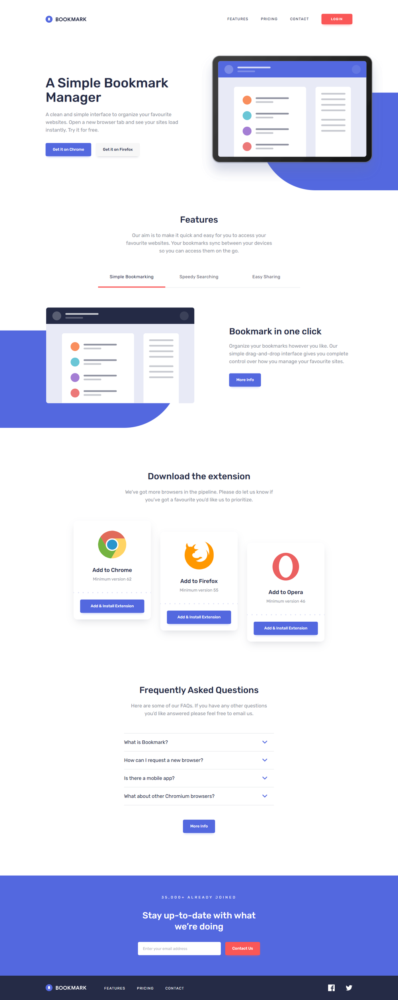

# Bookmark - Strona produktowa

**Zadanie rekrutacyjne na stanowisko Junior Front-end Developer: responsywna strona produktowa rozszerzenia przeglądarki „Bookmark”, zbudowana dwa razy - w Reakcie i w Angularze.**


**Strony na żywo:** [React](https://bookmark-landing-react-stan.netlify.app) | [Angular](https://bookmark-landing-angular-stan.netlify.app)

[🇬🇧 English](README.en.md) | 🇵🇱 Polski

---

## Dwie wersje

Obie wersje wyglądają i działają tak samo: ten sam projekt graficzny, modal, walidacja newslettera, licznik, dostępność i testy. Różni je stack.

| Wersja             | Folder               | Stack                                                     | Dokumentacja                |
| ------------------ | -------------------- | --------------------------------------------------------- | --------------------------- |
| **React** (główna) | [`react`](react)     | React 19, TypeScript, Webpack 5, Babel, Sass              | [README](react/README.md)   |
| Angular            | [`angular`](angular) | Angular 22 (standalone, sygnały, zoneless), esbuild, Sass | [README](angular/README.md) |

Wersja React używa narzędzi wymienionych w zadaniu (Webpack, Babel, Sass, React). Wersja Angular jest dodatkiem.



---

## Uruchomienie

Każda wersja to osobny projekt z własnym `package.json`. Wymagany Node.js 22.12 lub nowszy (w repozytorium jest `.nvmrc` z wersją 24).

```bash
cd react           # albo: cd angular
npm install
npm start          # React: http://localhost:3000, Angular: http://localhost:4200
npm run check      # typy, lint, format, testy (w Angularze także build produkcyjny)
```

---

## Deploy (Netlify)

| Ustawienie         | React                         | Angular                         |
| ------------------ | ----------------------------- | ------------------------------- |
| Base directory     | `react`                       | `angular`                       |
| Komenda builda     | `npm run build`               | `npm run build`                 |
| Katalog publikacji | `dist`                        | `dist/bookmark-landing/browser` |
| Wersja Node.js     | 24 (`netlify.toml`, `.nvmrc`) | 24 (`netlify.toml`, `.nvmrc`)   |

---

## Struktura repozytorium

```
.
├─ react/                  # wersja React (Webpack, Babel, Sass)
├─ angular/                # wersja Angular (esbuild, Sass)
├─ README.md · README.en.md
└─ .gitignore · .gitattributes
```
