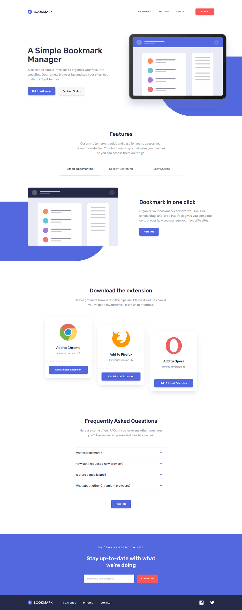
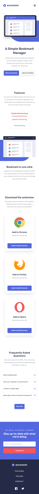
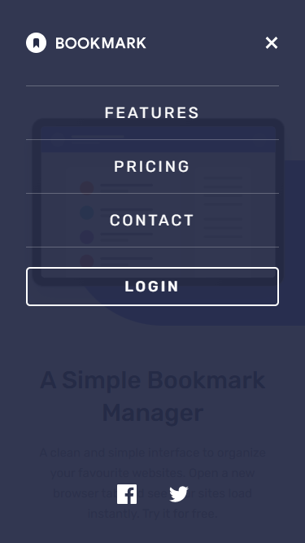
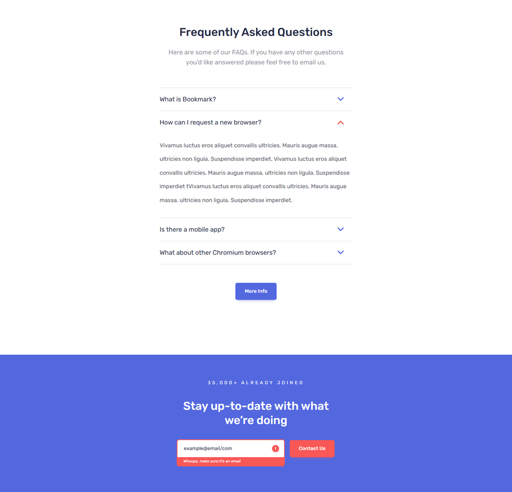

# Bookmark - Strona produktowa (Angular)

**Responsywna strona produktowa rozszerzenia przeglądarki „Bookmark” - zadanie rekrutacyjne na stanowisko Junior Front-end Developer. Odwzorowanie projektu graficznego (mobile 375 px / desktop 1440 px) wraz z modalem, walidacją newslettera i animowanym licznikiem, zbudowane w najnowszym Angularze.**


<!-- Po deployu odkomentuj i uzupełnij: **Strona na żywo:** [adres-aplikacji](https://adres-aplikacji) -->

[🇬🇧 English](README.en.md) | 🇵🇱 Polski

> Ta sama strona w Reakcie (wersja z Webpack, Babel i Sass wymienionymi w zadaniu): [`react`](../react).

---

## Czym jest ten projekt

Strona produktowa zbudowana według dostarczonych projektów graficznych (`mobile-design.jpg`, `desktop-design.jpg` i widoki stanów aktywnych) oraz wytycznych z `style-guide.md` (kolory, font Rubik, rozmiar bazowy 18 px). Całość jest podzielona na małe, samodzielne komponenty (standalone), ostylowana w Sass z nazewnictwem **BEM** i pokryta testami jednostkowymi.

Wyglądem i zachowaniem ta wersja jest identyczna z wersją React.

---

## Zrzuty ekranu

### Desktop (1440 px)



### Mobile (375 px) i menu mobilne

<p>
  
  &nbsp;&nbsp;
  
</p>

### Modal (po najechaniu na header)


### Stany aktywne - otwarte FAQ i błąd w newsletterze



---

## Sekcje strony

| Sekcja     | Zawartość                                                                                 |
| ---------- | ----------------------------------------------------------------------------------------- |
| Header     | Logo, nawigacja, przycisk Login; na mobile - menu pełnoekranowe                           |
| Hero       | Nagłówek, opis, przyciski „Get it on Chrome / Firefox”, ilustracja z niebieskim kształtem |
| Features   | Zakładki (Simple Bookmarking / Speedy Searching / Easy Sharing) z treścią i ilustracją    |
| Download   | Trzy karty przeglądarek (Chrome, Firefox, Opera)                                          |
| FAQ        | Akordeon z czterema pytaniami                                                             |
| Newsletter | Formularz z walidacją i licznikiem „35,000+ already joined”                               |
| Footer     | Logo, linki, ikony społecznościowe                                                        |

---

## Funkcjonalności

### Interfejs

- **Responsywny układ** - projekt mobile-first; progi: 768 px (typografia, układ nawigacji) i 1100 px (układ dwukolumnowy hero, panelu zakładek i kart)
- **Menu mobilne** - pełnoekranowe, blokuje przewijanie strony, zamykane klawiszem `Esc` lub wyborem linku
- **Zakładki** - wzorzec WAI-ARIA tabs: strzałki, `Home`, `End`, roving `tabindex`
- **Akordeon FAQ** - jedna otwarta odpowiedź naraz, płynne rozwijanie samym CSS (`grid-template-rows`)

### Newsletter

- Walidacja przy wysyłce i przy opuszczeniu pola (tylko jeśli użytkownik zaczął pisać); po pojawieniu się błędu walidacja działa na żywo
- Komunikat błędu z `role="alert"`, powiązany z polem przez `aria-describedby`
- Potwierdzenie wysyłki z `role="status"`
- Jedno pole obsłużone sygnałami - bez biblioteki formularzy

### Modal i licznik

- **Modal** - natywny `<dialog>`: pułapka fokusu, `Esc` i inertne tło za darmo; zamykany także kliknięciem w tło
- **Wyzwalacze** - najechanie na header, wyjście kursora górą poza stronę, 30 s od wejścia; pokazywany raz
- **Licznik** - 20 s, `requestAnimationFrame`, sprzątanie przy zniszczeniu komponentu; dla czytników ekranu stała etykieta „Over 35,000”

### Grafika

- **Niebieskie kształty** rysowane w CSS
- **SVG inline** z `currentColor` i zmiennymi CSS - kolory zmieniane stanami i wariantami, bez duplikowania plików

### Nowoczesny Angular

- **Komponenty standalone**, **sygnały** (`signal`, `computed`, `linkedSignal`, `input()`, `output()`), nowa składnia szablonów (`@if`, `@for`, `@switch`)
- **Zoneless** - bez `zone.js`, `ChangeDetectionStrategy.OnPush` w każdym komponencie
- **Przycisk jako komponent z selektorem atrybutowym** (`<a appButton>`, `<button appButton>`) - zachowuje natywny element i jego semantykę, a komponent odpowiada tylko za wygląd
- **`host` w metadanych** zamiast `@HostBinding` / `@HostListener`

### Jakość

- **BEM** (`block__element--modifier`) w całym projekcie
- **Wydajność** - font Rubik hostowany lokalnie (tylko podzbiór latin, wagi 400/500), lazy loading logotypów przeglądarek w kartach pobierania, hashowane zasoby; ok. 188 KB JavaScriptu (ok. 54 KB po kompresji)
- **Testy jednostkowe** - ponad 70 testów (Vitest + TestBed)

---

## Dostępność

**Co zostało zrobione**

- **Semantyka** - landmarki (`header`, `nav` z etykietami, `main`, `footer`), hierarchia nagłówków `h1 → h2 → h3` bez przeskoków, `lang="en"`, link „Skip to main content”
- **Klawiatura** - całość obsługiwana bez myszy; widoczny fokus (2 px) z kontrastem co najmniej 3:1 także na niebieskim pasku newslettera, w granatowej stopce i w menu mobilnym (kolor pierścienia to zmienna CSS `--focus-ring`)
- **Menu mobilne i modal** - strona za otwartą nakładką jest `inert` (fokus ani czytnik ekranu nie wychodzą poza menu), `Esc` zamyka menu i oddaje fokus przyciskowi; modal to natywny `<dialog>` z pułapką fokusu
- **Formularz** - etykieta pola, `aria-invalid`, `aria-describedby`, komunikat `role="alert"`, a po nieudanej wysyłce fokus trafia na pole do poprawy
- **Ruch** - `prefers-reduced-motion` wyłącza przejścia i animacje, a licznik od razu pokazuje wartość końcową
- **Cele dotykowe** - co najmniej 24×24 px (WCAG 2.5.8); linki otwierające nową kartę informują o tym w swojej nazwie

**Jak to sprawdziłem**

- **axe-core 4.14** (reguły WCAG 2.0 / 2.1 / 2.2 na poziomach A i AA oraz dobre praktyki) na rzeczywistych stanach strony: widok domyślny, zakładka + otwarte FAQ + błąd newslettera, modal, mobile i otwarte menu mobilne
- **Skrypt klawiatury** - kolejność Tab, widoczność i kontrast fokusu, zawartość fokusu w menu i modalu, rozmiary celów, reduced motion, struktura dokumentu
- **Testy jednostkowe** zachowań a11y (inert, powrót fokusu, fokus na błędnym polu, reduced motion, skip link, etykiety linków)

**Znane ograniczenia (świadome)**

- **Kontrast kolorów z projektu.** Szary tekst `#9194a1` na białym ma 3,02:1, a biały tekst na czerwonych przyciskach (`Login`, `Contact Us`) 3,20:1 - poniżej wymaganych 4,5:1 dla AA. Kolory zostały zgodne z projektem graficznym i jest to jedyna reguła, którą wykrywa axe. Gdyby projekt mógł się zmienić, wystarczy szary `hsl(229, 8%, 48%)` (4,63:1) i czerwień przycisków `hsl(0, 94%, 48%)` (4,53:1).
- **Linki zastępcze.** `#pricing`, `#login`, `#chrome`, `#firefox`, `#opera` i `#more-info` nie mają stron docelowych, bo zadanie ich nie dostarcza.
- **Licznik** animuje się 20 s bez przycisku pauzy (tak wymaga zadanie); użytkownikom z włączonym ograniczeniem ruchu wartość końcowa pokazuje się od razu (WCAG 2.2.2).

---

## Decyzje projektowe

W kilku miejscach świadomie odszedłem od dosłownej treści zadania lub ją doprecyzowałem:

- **Kierunek licznika.** Zadanie mówi, że liczba „35,000+” ma _spadać_ do 0 w ciągu 20 s. Licznik, który maleje do zera, sugeruje odwrotność tego, co chce pokazać sekcja „already joined”, więc liczba **rośnie od 0 do 35,000+** i na tym się zatrzymuje. Odwrócenie kierunku to zmiana dwóch linii (wartość początkowa i wzór) w `src/app/utils/count-up.ts`.
- **Walidacja e-maila.** Zadanie wymaga co najmniej znaku `@`. Projekt pokazuje jednak błąd także dla `example@email/com`, więc wzorzec to `x@y.z` (adres z `@` i domeną z kropką) - nadzbiór reguły z zadania.
- **„Najechanie na górną część strony”.** Zinterpretowane jako wejście kursora na header. Na ekranach dotykowych (`(hover: none)`) ten wyzwalacz jest pomijany, bo dotknięcie hamburgera emulowałoby `mouseenter` i otwierało modal zamiast menu; timer 30 s działa wszędzie.
- **Modal raz na wizytę.** Po zamknięciu nie wraca, niezależnie od wyzwalacza.
- **Próg 1100 px.** Projekty istnieją tylko dla 375 px i 1440 px; 1100 px to szerokość, od której układ desktopowy mieści się bez przycinania.
- **Formularz bez biblioteki.** Pojedyncze pole nie uzasadnia Reactive Forms; Signal Forms nie miały w dokumentacji Angulara 22 potwierdzonego statusu stabilnego, więc stan pola trzymają zwykłe sygnały.

---

## Stack technologiczny

| Warstwa     | Technologia                                                       |
| ----------- | ----------------------------------------------------------------- |
| Framework   | Angular 22 (standalone, sygnały, zoneless, `OnPush`)              |
| Język       | TypeScript 6 (strict)                                             |
| Builder     | `@angular/build:application` (esbuild + serwer deweloperski Vite) |
| Style       | Sass (SCSS), BEM, style komponentów (emulated encapsulation)      |
| Font        | Rubik (`@fontsource/rubik`)                                       |
| Testy       | Vitest 5 przez `ng test`, `TestBed`, jsdom                        |
| Jakość kodu | angular-eslint 22 (ESLint 10, `typescript-eslint`), Prettier 3    |

---

## Struktura projektu

```
.
├─ public/                    # favicon, ilustracje i logotypy z zadania
├─ src/
│  ├─ app/
│  │  ├─ ui/                  # button, logo, icon, blue-shape, modal, section-heading, social-links
│  │  ├─ layout/              # header (menu mobilne), footer
│  │  ├─ sections/            # hero, features (+ feature-tabs), download (+ browser-card), faq (+ faq-item), newsletter
│  │  ├─ utils/               # count-up (licznik oparty na sygnałach)
│  │  ├─ data/content.ts      # treści i dane (typowane)
│  │  └─ app.ts · app.html    # komponent główny, wyzwalacze modala
│  ├─ assets/                 # tło kropkowanego separatora
│  ├─ styles/                 # zmienne i mixiny Sass
│  ├─ testing/                # pomocnicze funkcje testów (matchMedia, DOM)
│  └─ test-setup.ts           # konfiguracja testów (polyfill <dialog>)
├─ images/                    # zrzuty ekranu do README
├─ angular.json · eslint.config.js · tsconfig*.json
└─ package.json
```

Testy (`*.spec.ts`) leżą obok testowanego kodu.

---

## Uruchomienie

Wymagany Node.js 22.12 lub nowszy.

```bash
npm install
npm start          # serwer deweloperski: http://localhost:4200
npm run build      # build produkcyjny -> dist/bookmark-landing/browser
npm test           # testy jednostkowe w trybie watch; npm run test:ci - jednorazowo
npm run lint       # angular-eslint (lint:fix - z autonaprawą)
npm run format     # Prettier (format:check - tylko sprawdzenie)
npm run check      # lint + format:check + testy + build produkcyjny
```

---

## Deploy

Aplikacja jest statyczna (brak routingu), więc działa na dowolnym hostingu statycznym. Ścieżki do obrazów są względne do `<base href>`, więc przy publikacji pod podścieżką wystarczy ustawić `--base-href`.

| Ustawienie                        | Wartość                                         |
| --------------------------------- | ----------------------------------------------- |
| Katalog projektu (przy monorepo)  | `angular`                                       |
| Komenda builda                    | `npm run build`                                 |
| Katalog publikacji                | `dist/bookmark-landing/browser`                 |
| Wersja Node.js                    | `24` (`.nvmrc`, `netlify.toml`)                 |
| Pod podścieżką (np. GitHub Pages) | `npx ng build --base-href /nazwa-repozytorium/` |

Ustawienia builda są też zapisane w `netlify.toml`, a wersja Node.js w `.nvmrc`.
