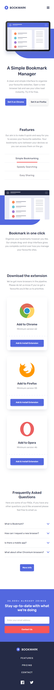
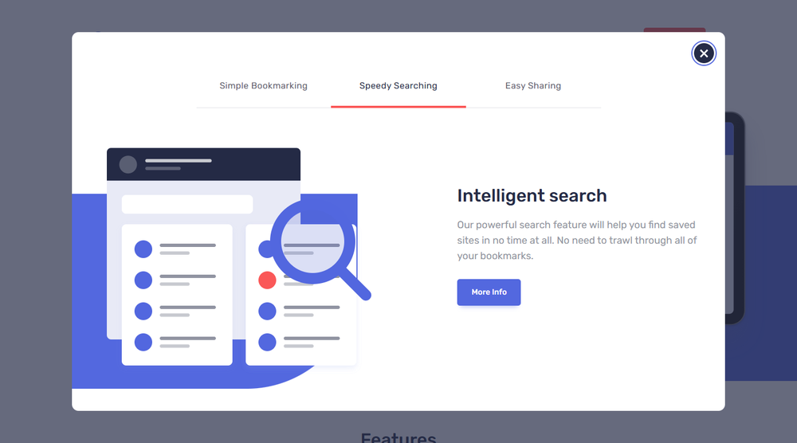
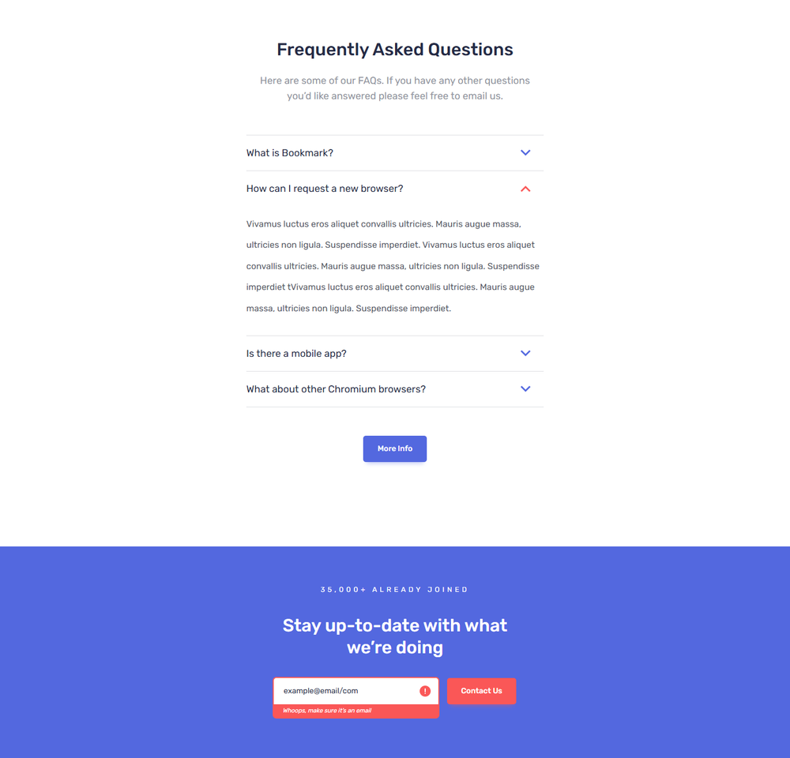

# Bookmark - Product Landing Page (React)

**Responsive product page for the “Bookmark” browser extension - a recruitment task for a Junior Front-end Developer position. A faithful recreation of the supplied design (mobile 375 px / desktop 1440 px) with a pop-up modal, newsletter validation and an animated counter.**


**Live site:** [bookmark-landing-react-stan.netlify.app](https://bookmark-landing-react-stan.netlify.app)

🇬🇧 English | [🇵🇱 Polski](README.md)

> The same page built with Angular: [`angular`](../angular).

---

## What it is

A product page built from the supplied design files (`mobile-design.jpg`, `desktop-design.jpg` and the active-state views) and the guidelines in `style-guide.md` (colours, Rubik font, 18 px base size). It is split into small reusable components, styled with Sass using **BEM** naming and covered by unit tests.

---

## Screenshots

### Desktop (1440 px)


### Mobile (375 px) and the mobile menu

<p>
  
  &nbsp;&nbsp;
  
</p>

### Modal (opened by hovering the header)



### Active states - open FAQ and newsletter error



---

## Page sections

| Section    | Content                                                                                      |
| ---------- | -------------------------------------------------------------------------------------------- |
| Header     | Logo, navigation, Login button; full-screen menu on mobile                                   |
| Hero       | Heading, copy, “Get it on Chrome / Firefox” buttons, illustration with a blue shape          |
| Features   | Tabs (Simple Bookmarking / Speedy Searching / Easy Sharing) with content and an illustration |
| Download   | Three browser cards (Chrome, Firefox, Opera)                                                 |
| FAQ        | Accordion with four questions                                                                |
| Newsletter | Form with validation and the “35,000+ already joined” counter                                |
| Footer     | Logo, links, social icons                                                                    |

---

## Features

### Interface

- **Responsive layout** - mobile-first; breakpoints at 768 px (typography, navigation layout) and 1100 px (two-column hero, feature panel and card row)
- **Mobile menu** - full-screen, locks page scroll, closes on `Esc` or when a link is chosen
- **Tabs** - WAI-ARIA tabs pattern: arrow keys, `Home`, `End`, roving `tabindex`
- **FAQ accordion** - one open answer at a time, smooth CSS-only expansion (`grid-template-rows`)

### Newsletter

- Validation on submit and when leaving the field (only if the user has started typing); once an error is shown, validation runs live
- Error message with `role="alert"`, linked to the input via `aria-describedby`
- Submission confirmation with `role="status"`

### Modal and counter

- **Modal** - native `<dialog>`: focus trap, `Esc` and an inert background for free; also closes on a backdrop click
- **Triggers** - hovering the header, leaving the page through the top, 30 s after entering; shown once
- **Counter** - 20 s, `requestAnimationFrame`, cleaned up on unmount; screen readers get a fixed “Over 35,000” label

### Graphics

- **Blue shapes** drawn in CSS
- **Inline SVG** with `currentColor` and CSS variables - colours change with states and variants, no duplicated files

### Quality

- **BEM** (`block__element--modifier`) throughout
- **Performance** - self-hosted Rubik (latin subset only, weights 400/500), lazy loading of the browser logos in the download cards, hashed assets; about 250 KB of JavaScript (uncompressed, mostly React itself)
- **Unit tests** - more than 70 tests (Vitest + React Testing Library)

---

## Accessibility

**What was done**

- **Semantics** - landmarks (`header`, labelled `nav`s, `main`, `footer`), a `h1 → h2 → h3` heading outline without skipped levels, `lang="en"`, a “Skip to main content” link
- **Keyboard** - everything works without a mouse; a visible focus ring (2 px) with at least 3:1 contrast, also on the blue newsletter band, in the navy footer and in the mobile menu (the ring colour is the `--focus-ring` CSS variable)
- **Mobile menu and modal** - the page behind an open overlay is `inert` (neither focus nor a screen reader can leave the menu), `Esc` closes the menu and hands focus back to its button; the modal is a native `<dialog>` with a focus trap
- **Form** - field label, `aria-invalid`, `aria-describedby`, a `role="alert"` message, and after a failed submit focus moves to the field that needs fixing
- **Motion** - `prefers-reduced-motion` switches off transitions and animations, and the counter shows its final value immediately
- **Targets** - at least 24×24 px (WCAG 2.5.8); links that open a new tab say so in their name

**How I checked**

- **axe-core 4.14** (WCAG 2.0 / 2.1 / 2.2 rules at levels A and AA plus best practices) on the page’s real states: default view, tab + open FAQ + newsletter error, modal, mobile, and the open mobile menu
- **Keyboard script** - Tab order, focus visibility and contrast, focus containment in the menu and modal, target sizes, reduced motion, document structure
- **Unit tests** for the a11y behaviours (inert, focus return, focus on the invalid field, reduced motion, skip link, link labels)

**Known limitations (deliberate)**

- **Colour contrast from the design.** The grey text `#9194a1` on white is 3.02:1, and white text on the red buttons (`Login`, `Contact Us`) is 3.20:1 - below the 4.5:1 AA requires. The colours were kept faithful to the design, and this is the only rule axe reports. If the design may change, a grey of `hsl(229, 8%, 48%)` (4.63:1) and a button red of `hsl(0, 94%, 48%)` (4.53:1) are enough.
- **Placeholder links.** `#pricing`, `#login`, `#chrome`, `#firefox`, `#opera` and `#more-info` have no destination pages because the task does not provide any.
- **The counter** animates for 20 s without a pause control (as the task requires); for users who prefer reduced motion the final value appears immediately (WCAG 2.2.2).

---

## Design decisions

In a few places I deliberately departed from, or clarified, the literal task text:

- **Counter direction.** The task says the “35,000+” figure should _fall_ to 0 within 20 s. A counter shrinking to zero suggests the opposite of what an “already joined” section wants to show, so the number **rises from 0 to 35,000+** and stops there. Reversing it takes two lines (the initial value and the formula) in `src/hooks/useCountUp.ts`.
- **E-mail validation.** The task requires at least an `@`. The design, however, also shows the error for `example@email/com`, so the pattern is `x@y.z` (an `@` plus a domain containing a dot) - a superset of the rule in the task.
- **“Hovering the top part of the page”.** Interpreted as the cursor entering the header. On touch screens (`(hover: none)`) this trigger is skipped, because tapping the hamburger would emulate `mouseenter` and open the modal instead of the menu; the 30 s timer works everywhere.
- **Modal once per visit.** After it is closed it never comes back, whichever trigger fires.
- **1100 px breakpoint.** The designs only exist for 375 px and 1440 px; 1100 px is the width from which the desktop layout fits without clipping.

---

## Tech stack

| Layer         | Technology                                                                               |
| ------------- | ---------------------------------------------------------------------------------------- |
| UI            | React 19 (function components, hooks)                                                    |
| Language      | TypeScript 6 (strict)                                                                    |
| Bundler       | Webpack 5                                                                                |
| Transpilation | Babel 8 (`preset-env`, `preset-react`, `preset-typescript`)                              |
| Styles        | Sass (SCSS), BEM                                                                         |
| Font          | Rubik (`@fontsource/rubik`)                                                              |
| Tests         | Vitest 5, React Testing Library, user-event, jsdom                                       |
| Code quality  | ESLint 9 (`typescript-eslint`, `react-hooks`, `jsx-a11y`, `testing-library`), Prettier 3 |

---

## Project structure

```
.
├─ public/                    # index.html, favicon
├─ src/
│  ├─ assets/images/          # illustrations and logos supplied with the task
│  ├─ components/
│  │  ├─ ui/                  # Button, Logo, Icons, BlueShape, Modal, SectionHeading, SocialLinks
│  │  ├─ layout/              # Header (mobile menu), Footer
│  │  └─ sections/            # Hero, Features (+ FeatureTabs), Download (+ BrowserCard), Faq (+ FaqItem), Newsletter
│  ├─ hooks/                  # useCountUp, useDelayedTrigger, useExitIntent
│  ├─ data/content.ts         # copy and data (typed)
│  ├─ styles/                 # variables, mixins, reset
│  ├─ test/                   # test setup (<dialog> polyfill, matchMedia)
│  ├─ App.tsx
│  └─ index.tsx
├─ images/                    # README screenshots
├─ babel.config.js · webpack.config.js · eslint.config.mjs · vitest.config.mjs
└─ package.json
```

Tests live next to the code they cover (`*.test.ts` / `*.test.tsx`).

---

## Getting started

Requires Node.js 22.12 or newer.

```bash
npm install
npm start          # dev server: http://localhost:3000
npm run build      # production build -> dist/
npm test           # unit tests (single run); npm run test:watch for watch mode
npm run lint       # ESLint (lint:fix to autofix)
npm run format     # Prettier (format:check to only verify)
npm run check      # typecheck + lint + format:check + tests
```

---

## Deployment

The app is static (no client-side routing), so it runs on any static host. Assets are linked relatively, so it also works under a sub-path (e.g. GitHub Pages).

| Setting                           | Value                           |
| --------------------------------- | ------------------------------- |
| Project directory (in a monorepo) | `react`                         |
| Build command                     | `npm run build`                 |
| Publish directory                 | `dist`                          |
| Node.js version                   | `24` (`.nvmrc`, `netlify.toml`) |

The build settings are also stored in `netlify.toml`, and the Node.js version in `.nvmrc`.
